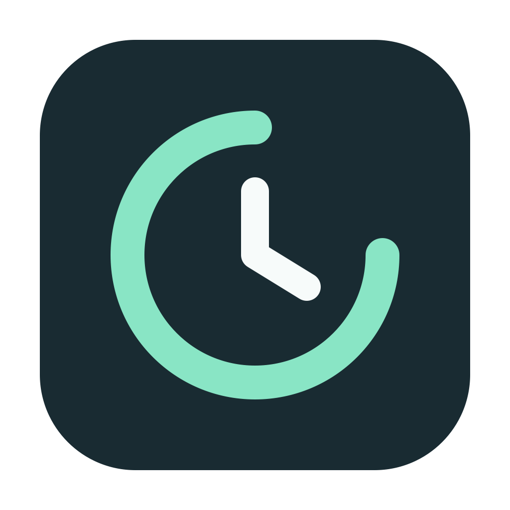

[English](#english) | [简体中文](#简体中文)

<p align="center">
  
</p>

<a id="english"></a>

# Codex Mini

A minimal native macOS menu bar app that shows your remaining Codex quota and the time until it resets.

**[Download for Apple Silicon](https://github.com/drfcy/codex-mini/releases/latest)** · [Usage](#usage) · [Build from source](#build-from-source)

<p align="center">
  
</p>
<p align="center"><sub>Illustration with sample data. The percentage shows your remaining quota.</sub></p>

## Features

- Shows the remaining percentage of your short-term quota and a reset countdown in the menu bar.
- Open the menu to view your weekly quota and reset times.
- Refreshes quota every minute and updates the countdown every 15 seconds.
- Offers Chinese and English time formats and remembers your choice.
- Supports manual refresh and launch at login; launch at login is off by default.
- Automatically tries the local Codex client if the direct connection fails.
- Built with Swift and AppKit, with no third-party code dependencies and no Dock icon.

## Download and installation

Requires **macOS 14 or later, an Apple Silicon (M-series) Mac**, and an existing ChatGPT account sign-in in Codex.

1. Download `Codex-Mini-v1.0.2-macOS-arm64.zip` from [Releases](https://github.com/drfcy/codex-mini/releases/latest).
2. Extract the ZIP and drag `Codex Mini.app` into Applications.
3. Open the app. Your quota and reset countdown will appear in the menu bar.

The current release is ad-hoc signed. It is not signed with an Apple Developer ID or notarized by Apple, so macOS may block it on first launch. After checking the download source and SHA-256 checksum, follow [Apple's instructions](https://support.apple.com/zh-cn/guide/mac-help/mh40616/mac) for Privacy & Security, or build the app from source.

To update, quit the old version from its menu before replacing the app in Applications. Avoid running multiple copies at the same time.

## Usage

`5h 97%` means that 97% of your five-hour quota remains. The time shown is the countdown until that quota resets.

| Time format | Example |
| --- | --- |
| 中文 | `5h 97% 4小时51分钟` |
| English | `5h 97% 4h 51m` |

Click the menu bar icon and choose a format under **时间语言** (Time language). Neither format adds a prefix or suffix such as “in” or “后”. Other menu labels are currently in Chinese.

The menu also includes **立即刷新** (Refresh now), **开机启动** (Launch at login), and **退出 Codex Mini** (Quit Codex Mini). There is no main window. After quitting, reopen the app from Applications.

`⚠︎` means the latest refresh failed or the data has not been updated for more than two and a half minutes. The menu shows the error and the last successful update time; any retained quota is the last successful reading. Once its reset time has passed, the old percentage becomes `--%` until fresh server data is available.

## Data and privacy

- Reuses the existing sign-in in `~/.codex/auth.json`, or the directory specified by `CODEX_HOME`.
- Requests usage from `https://chatgpt.com/backend-api/wham/usage` and does not save a separate copy of your login tokens.
- If the direct HTTP request encounters a connection error, it falls back to the local Codex client's `account/rateLimits/read` method. The child process is closed afterward; it does not create chats or run model tasks.
- The fallback client inherits the current proxy environment. If the relevant variables are absent, it uses the system's static HTTP/HTTPS proxy settings for that child process without changing system network settings.
- Codex Mini does not write to the login file. The Codex client may renew its own sign-in according to its normal behavior.
- Does not read browser cookies, Keychain items, or chat content. No telemetry, ads, or automatic updates.

The app depends on Codex's existing usage data format. Server-side changes may affect quota retrieval. This is an independent open-source tool and is not affiliated with OpenAI.

## Build from source

Requires macOS, Xcode or compatible Command Line Tools, and Swift 6. No third-party dependencies are needed.

```sh
git clone https://github.com/drfcy/codex-mini.git
cd codex-mini
./build.sh
```

The app is generated at `.build/Codex Mini.app`. Copy it into Applications before running it. The build targets macOS 14+ / arm64.

To choose another output directory:

```sh
./build.sh "/your/output/directory/Codex Mini.app"
```

Run the offline parsing and formatting tests:

```sh
./Scripts/test.sh
```

To verify live quota retrieval yourself (uses your current Codex sign-in and prints only quota and time):

```sh
xcrun swiftc -swift-version 6 Sources/Usage.swift Tests/LiveCheck.swift -o .build/live-check
.build/live-check
.build/live-check --test-fallback
```

`--test-fallback` simulates a TLS error on the direct connection and then checks the real Codex client fallback. CI does not run tests that require a real account.

## Icon not updating

If LaunchOS or another launcher still shows an old or placeholder icon, fully quit and reopen the launcher. If the problem persists, refresh only this app's system registration, then reopen the launcher:

```sh
touch "/Applications/Codex Mini.app"
/System/Library/Frameworks/CoreServices.framework/Frameworks/LaunchServices.framework/Support/lsregister -f "/Applications/Codex Mini.app"
```

Keep old-version backups as ZIP archives to avoid registering multiple `.app` copies.

## Acknowledgments and license

The usage endpoint, response format, and fallback approach were informed by [CodexBar](https://github.com/steipete/CodexBar). This project independently implements a minimal menu bar interface with original ring-and-clock SVG icons.

Licensed under the [MIT License](LICENSE). See [THIRD_PARTY_NOTICES.txt](THIRD_PARTY_NOTICES.txt) for the reference project's license.

---

<a id="简体中文"></a>

# Codex Mini · 简体中文

一个简单的 macOS 菜单栏工具：看一眼，就知道 Codex 还剩多少额度、多久重置。

**[下载 Apple Silicon 版](https://github.com/drfcy/codex-mini/releases/latest)** · [使用说明](#使用) · [从源码构建](#从源码构建)

<p align="center">
  
</p>
<p align="center"><sub>显示效果示意，使用示例数据；百分比表示剩余额度。</sub></p>

## 功能

- 菜单栏显示短周期额度的剩余百分比，以及距离重置的时间。
- 点开菜单可查看周额度和重置时间。
- 用量每分钟更新，倒计时每 15 秒更新。
- 时间可选中文 / English，并记住选择。
- 支持手动刷新与开机启动；开机启动默认关闭。
- 直接连接失败时，自动尝试通过本机 Codex 客户端读取额度。
- 原生 Swift / AppKit，无第三方代码依赖，无 Dock 图标。

## 下载与安装

要求 **macOS 14 或更新版本、Apple Silicon（M 系列芯片）Mac**，并已在 Codex 中登录 ChatGPT 账号。

1. 从 [Releases](https://github.com/drfcy/codex-mini/releases/latest) 下载 `Codex-Mini-v1.0.2-macOS-arm64.zip`。
2. 解压，将 `Codex Mini.app` 拖到“应用程序”文件夹。
3. 打开应用，菜单栏即可看到额度与倒计时。

当前发布包采用临时签名，未使用 Apple Developer ID 签名，也未经过 Apple 公证。首次打开可能受到 macOS 安全检查阻止；确认下载来源和 SHA-256 校验值后，可按照 [Apple 的说明](https://support.apple.com/zh-cn/guide/mac-help/mh40616/mac) 在系统设置的“隐私与安全”中处理，或自行从源码构建。

更新时先从菜单中退出旧版，再替换“应用程序”中的应用。不要同时运行多份副本。

## 使用

菜单栏中的 `5h 97%` 表示 5 小时额度还剩 97%。时间表示距离额度重置的时长。

| 时间语言 | 示例 |
| --- | --- |
| 中文 | `5h 97% 4小时51分钟` |
| English | `5h 97% 4h 51m` |

点击菜单栏图标，在“时间语言”中切换。时间不添加“后”或“in”。主界面的其他菜单文字为中文。

菜单还提供“立即刷新”“开机启动”和“退出 Codex Mini”。应用没有主窗口；退出后，从“应用程序”中重新打开即可。

出现 `⚠︎` 表示最近一次刷新失败，或数据超过两分半未更新。菜单会说明错误并显示最近成功更新时间；已有额度仅作为上次读取结果保留。重置时间已经过去时，旧百分比会改为 `--%`，等待新的服务器数据。

## 数据与隐私

- 使用本机 `~/.codex/auth.json` 中的现有登录状态；设置了 `CODEX_HOME` 时，使用该目录。
- 仅向 `https://chatgpt.com/backend-api/wham/usage` 请求用量，不另存登录令牌。
- 直接 HTTP 请求发生连接错误时，调用本机 Codex 的 `account/rateLimits/read` 作为备用通道，读取结束即关闭该子进程；不创建聊天或执行模型任务。
- 备用客户端继承当前代理环境；缺少相关环境变量时，将系统静态 HTTP/HTTPS 代理用于该子进程，不修改系统网络设置。
- Codex Mini 不写入登录文件；Codex 客户端可能按自身规则续期登录状态。
- 不读取浏览器 Cookie、钥匙串或聊天内容，无遥测、广告、自动更新。

该工具依赖 Codex 现有的用量数据格式，服务端接口变化可能影响读取。它是独立开源工具，与 OpenAI 没有隶属关系。

## 从源码构建

需要 macOS、Xcode 或兼容的 Command Line Tools，以及 Swift 6。无需安装第三方依赖。

```sh
git clone https://github.com/drfcy/codex-mini.git
cd codex-mini
./build.sh
```

应用生成在 `.build/Codex Mini.app`。将它复制到“应用程序”文件夹后再运行。构建目标为 macOS 14+ / arm64。

指定其他输出目录：

```sh
./build.sh "/你的输出目录/Codex Mini.app"
```

运行不联网的解析与格式测试：

```sh
./Scripts/test.sh
```

如需自行验证实际读取（会使用当前用户的 Codex 登录状态，只输出额度与时间）：

```sh
xcrun swiftc -swift-version 6 Sources/Usage.swift Tests/LiveCheck.swift -o .build/live-check
.build/live-check
.build/live-check --test-fallback
```

`--test-fallback` 模拟直接连接出现 TLS 错误，再验证真正的 Codex 客户端备用通道。CI 不运行任何需要真实账号的测试。

## 图标未更新

如果 LaunchOS 等启动器仍显示旧图标或占位图，先完全退出并重新打开启动器。如果仍未恢复，可以只刷新该应用的系统登记，然后再重新打开启动器：

```sh
touch "/Applications/Codex Mini.app"
/System/Library/Frameworks/CoreServices.framework/Frameworks/LaunchServices.framework/Support/lsregister -f "/Applications/Codex Mini.app"
```

旧版备份建议保存为 ZIP，避免多份 `.app` 被系统重复识别。

## 致谢与许可

用量接口、响应格式和备用读取方式参考了 [CodexBar](https://github.com/steipete/CodexBar)。本项目独立实现精简的菜单栏界面，圆环时钟图标为原创 SVG。

本项目使用 [MIT License](LICENSE)。参考项目许可见 [THIRD_PARTY_NOTICES.txt](THIRD_PARTY_NOTICES.txt)。
